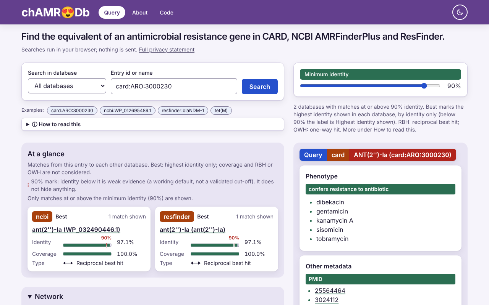
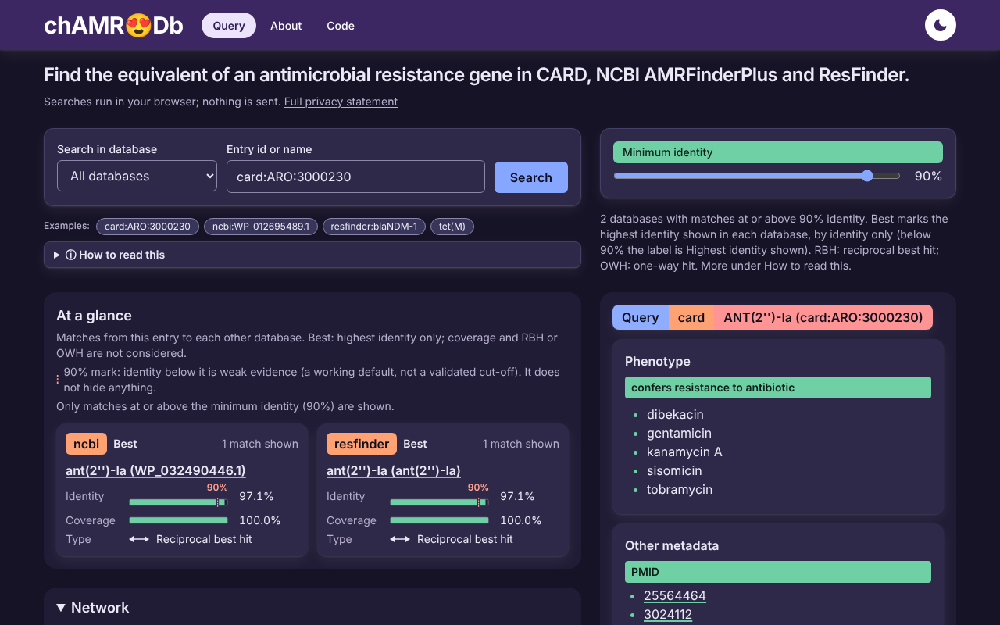
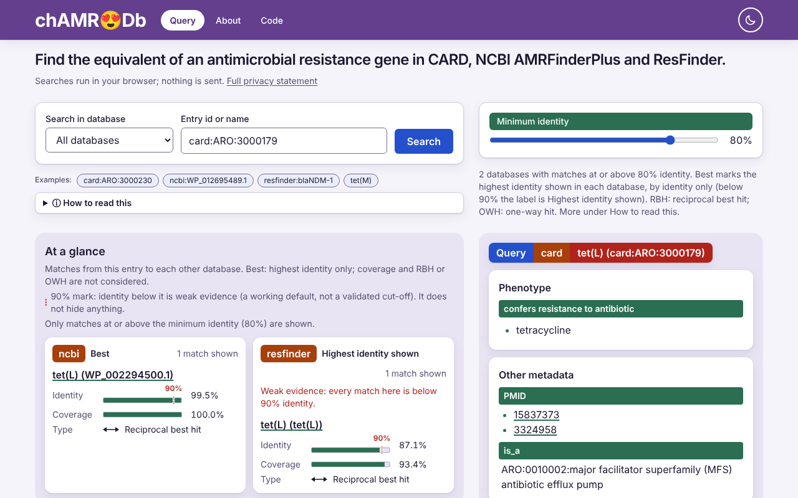
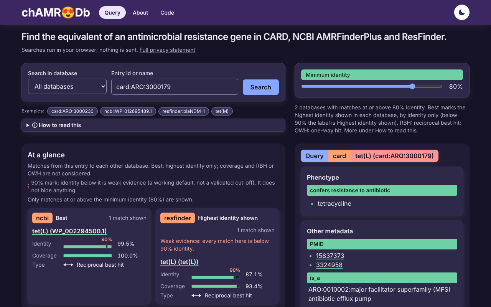
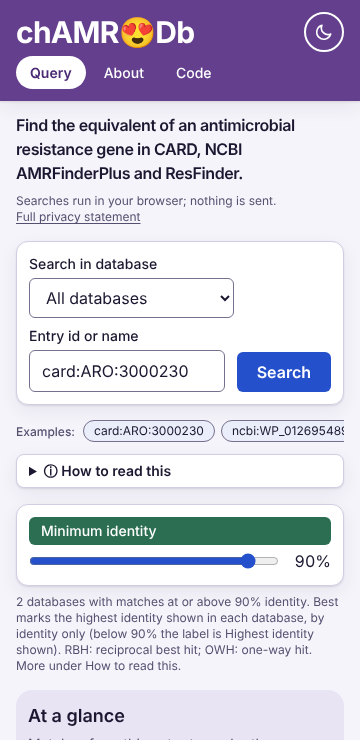
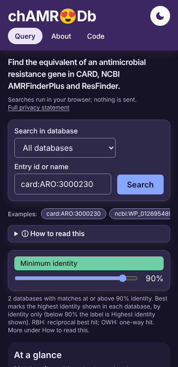
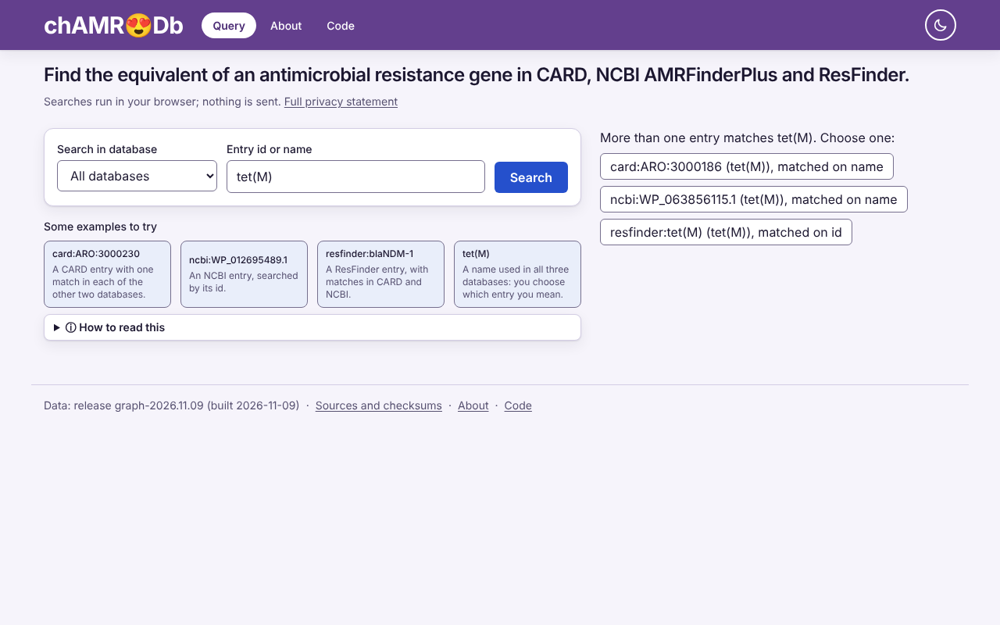
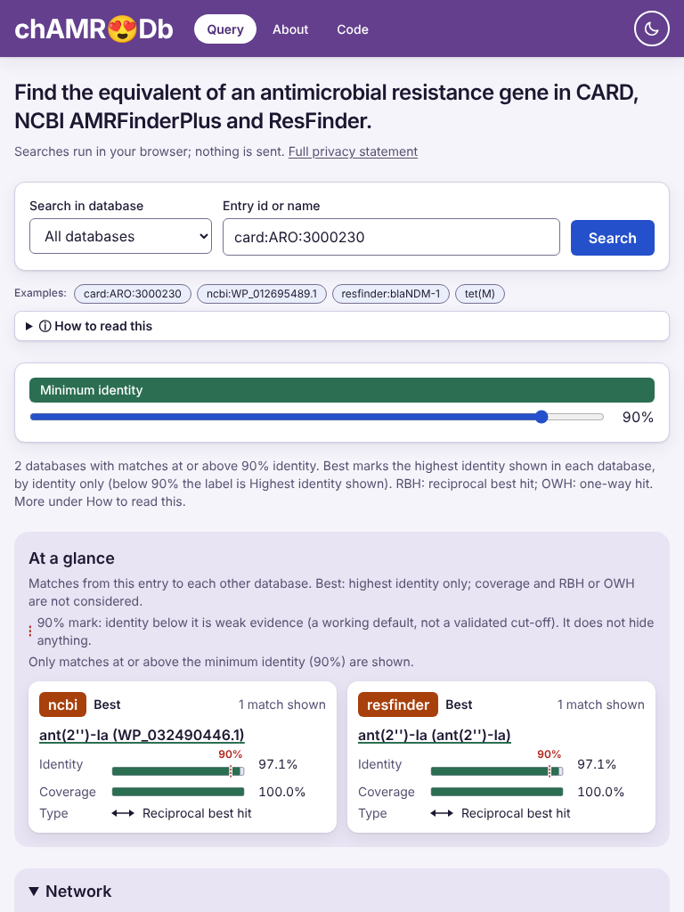

# chAMReDB live

Static web app to look up an antimicrobial resistance gene in CARD, NCBI AMRFinderPlus or ResFinder and see its matches in the other databases. Everything runs in the browser; no backend.

Live site: https://antunderwood.github.io/chamredb-live/ (GitHub Pages, built by `.github/workflows/pages.yml`). The old Render site only redirects here.

## Screenshots

Taken on the release build (`graph-2026.11.09`) with the page as shipped; `docs/screenshots/`.

| | Light | Dark |
|---|---|---|
| A result, 1280 px (`card:ARO:3000230`) |  |  |
| Weak evidence, 1280 px (`card:ARO:3000179` at 80%): the ResFinder group is labelled Highest identity shown |  |  |
| Phone, 360 px |  |  |

An ambiguous name (`tet(M)` is in all three databases, so you choose which entry you mean), and the layout at 768 px:




## Develop

Node version in `.nvmrc`.

```
npm ci
npm test            # Vitest, hand-worked fixture
npm run build       # tsc + vite build into dist/
npm run e2e         # Playwright egress test against the built app (npx playwright install chromium once)
```

The build ships the pinned ChamRedB release in `data/` (`data/README.md`; the build fails if its sha256 differs from `data/provenance.json`). The e2e tests build a hand-written fixture graph into `dist-e2e` (`GRAPH` and `OUT_DIR`); a non-release `GRAPH` must set `OUT_DIR` so it cannot land in `dist`.

Specs, scoping and decisions: `docs/`, `GLOSSARY.md`. How correctness is checked: `docs/oracles.md`.
